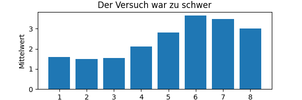
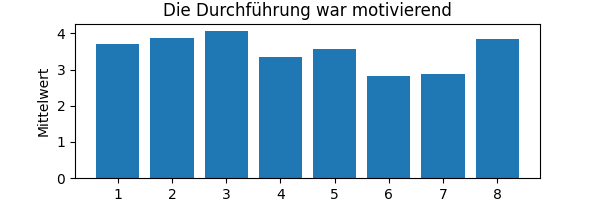

# Das ideale Praktikum?

Laborpraktika, (kurz Praktika) sind ein fester Bestandteil der Lehrpläne in den Naturwissenschaften und im speziellen in der Physik. In diesen Praktika wenden die Studierenden die Inhalte der theoretischen Lehrveranstaltungen in der Praxis an, um aufgestellte Modelle zu widerlegen oder zu bestätigen. Die dedizierten Lernziele der Praktika waren und sind jedoch oft nicht klar definiert. In der aktuellen Fachliteratur wird derzeit noch diskutiert, was sinnvolle Lernziele von Praktika sind. Ein öfters angegebenes Lernziel ist, dass das Praktikum die Wirksamkeit der Vorlesungen erhöhen soll. Das bedeutet: das Fachwissen der Studierenden sollte mithilfe der Praktika vertieft oder erweitert werden. Ein weiteres gebräuchliches Lernziel ist es, den Studierenden eine Einführung in das experimentelle wissenschaftliche Arbeiten zu vermitteln. Studien haben ergeben, dass diese zwei Lernziele mit der üblichen Art der Durchführung der Praktika oft nicht erfüllt werden. Eine ausführliche Analyse der Studien ist im Rahmen dieser Arbeit nicht sinnvoll, daher verweisen wir hier auf die Dissertation von Anna Brigitte Bauer [@bauer_experimentelle_2023], in deren Einführung der aktuelle Wissensstand verständlich dargestellt wird. In dieser Dissertation werden die Ergebnisse einer wegweisenden Studie zur Wirksamkeit von Praktika [@toothacker_critical_1983] wie folgt zusammengefasst:

> "Zum einen scheint die Kopplung von Vorlesungen und Praktika nicht zu einer höheren Lernwirksamkeit der Vorlesungen zu führen. Weiterhin scheinen Laborpraktika nicht dazu zu führen, dass Studierende ein angemessenes Bild zur Natur der Naturwissenschaft entwickeln. Schlussendlich konnten damals keine signifikanten Unterschiede hinsichtlich der experimentellen Fähigkeiten zwischen Studierenden mit und ohne Laborpraktikum gefunden werden."

Diese und weitere [@holmes_introductory_2018; @smith_direct_2020] Studien legten also nahe, dass Praktika die Vermittlung von grundlegenden experimentellen Fähigkeiten zum Ziel haben sollten, anstatt die Wirksamkeit der Vorlesungen zu erhöhen. Weiters wird argumentiert, dass die derzeit verbreitete Durchführung der Praktika nicht gut geeignet ist, um den Studierenden experimentelle Fähigkeiten anzueignen. In der Dissertation [@bauer_experimentelle_2023] wird weiters folgende Zusammenfassung der wissenschaftlichen Forschung zu den empfohlenen Lernzielen von Praktika angegeben:

> "Konsens ist, dass Studierende in Laborpraktika grundlegende experimentelle Fähigkeiten und Fertigkeiten erwerben sowie einen Einblick in das Experiment als Erkenntnismethodik der Wissenschaft Physik erhalten sollen."

Diese Ziele wurden im Bologna Prozess im Rahmen der kompetenzorientierten Lehre in die Studienpläne aufgenommen. Jedoch folgte an vielen Universitäten auf die Änderung dieser Ziele keine grundlegende Anpassung der Durchführung der Praktika [@schaper_fachgutachten_2012]. Von Seiten der Forschung gibt es Ansätze zur Durchführung von Praktika im deutschen und amerikanischen Raum [@alemani_scaffolded_2024; @walsh_skills-focused_2022; @bauer_experimentelle_2023; @smith_best_2021], die jedoch noch keine allgemeine Verbreitung in der Lehrtätigkeit der Universitäten gefunden haben.

In [@bauer_experimentelle_2023 Seite 249 ff] wird weiters argumentiert, dass einheitliche Zielsetzungen und Durchführungen von Praktika derzeit nicht existieren und auch im Rahmen der existierenden Forschung nicht eindeutig vorgegeben werden können:

> ... Hier ist insbesondere erschwerend, dass unklar ist, in welcher Weise die Kompetenzmodelle oder Messinstrumente angepasst werden müssten, da die zentralen charakteristischen Merkmale universitären Experimentierens nicht ausreichend präzisiert sind. Mit Bezug auf das Veranstaltungsformat Laborpraktikum kann festgestellt werden, dass es kein einheitliches Curriculum, keine differenzierten Zielsetzungen und keine Strukturierungen der experimentellen Fähigkeiten und Fertigkeiten gibt.

Ein weiterer kritischer und oft übersehener Punkt, welcher die Wirksamkeit von Praktika entscheidend beeinflusst, ist durch die Ausbildung und Motivation der Lehrenden gegeben, wie auch [@bauer_experimentelle_2023] zitiert:

> "Allerdings sind diese \[innovativen\] Konzepte \[für Laborpraktika\] keineswegs didaktische Selbstläufer, wie viele Studien belegen. Der Erfolg ihrer Lernumgebung hängt vielmehr maßgeblich von der Motivation, dem Interesse und den Voraussetzungen der Lernenden ab. Ein noch stärkerer Faktor scheint aber vielen Kommentaren und Untersuchungen zufolge die Person des Betreuenden zu sein. \[...\] Ausbildung, Motivation und Haltungen der Betreuenden dem Praktikum gegenüber \[legen\] oftmals eine obere Grenze des Erfolgs der Veranstaltung fest \[...\]." [@heinicke_aus_nodate Seite 656]

### Zielsetzung des Praktikums

Im Folgenden sollen die Lernziele für das Einsteigerpraktikum an der Universität Innsbruck analysiert und auch konkretisiert werden. Wie in der Einleitung beschrieben ist es nach derzeitigem Wissensstand nicht möglich eindeutige und messbare Ziele zu definieren. Deshalb konzentrieren wir uns hier darauf, die existierende Lehrveranstaltungen auf die oben beschriebenen Empfehlungen auszurichten [@bauer_experimentelle_2023]. Die hier beschriebene Adaptierung des Einsteigerpraktikums richtet sich an folgende Prinzipien:

::: callout-important
# Allgemeine Konzepte für Praktika

-   Die übergeordneten Lernziele fokussieren sich auf experimentelle Kompetenzen, anstatt auf die Vermittlung von physikalischem Wissen.
-   Die Vermittlung der unterschiedlichen Kompetenzen soll, soweit möglich, getrennt voneinander erfolgen.
-   Die Koordination und Motivation der Lehrenden soll optimiert werden.
:::

Spezifische Lernziele für ein Praktikum können in vier Gruppen, die in [@zwickl_process_2013] eingeführt wurden, eingeteilt werden: Kommunikation, Modellierung, technische Kompetenzen und Entwicklung. Für das in dieser Arbeit behandelte Einsteigerpraktikum können diese spezifischen Lernziele folgendermaßen implementiert werden:

::: callout-important
## Spezifische Lernziele für das Einsteigerpraktikum

-   **Kommunikation:** Schriftliche Berichtslegung; mündliche Diskussion und Verteidigung.
-   **Modellierung:** Erstellung eines realistischen Modells; Statistische Analyse um Ergebnisse mit dem Modell zu Vergleichen
-   **technische Kompetenzen:** Computergestützte Datenauswertung. Korrekte Benutzung von Messgeräten.
-   **Entwicklung:** Entwicklung und Fehlersuche eines Experimentaufbaus
:::

Diese Ziele sind generell auf viele Praktika in den Natur- und technischen Wissenschaften anwendbar. Diese Arbeit konzentriert sich auf die Pflichtpraktika im Studienplan des BSc Physik an der Universität Innsbruck. Im aktuellen Studienplan 2025WS sind folgende Praktika vorgesehen:

1.   Grundpraktikum 1 (GP1), welches jeweils im Wintersemester (WS) und im Sommersemester (SS) angeboten wird. Es wird empfohlen das GP1 im 3. Semester (WS) zu absolvieren. 
2.   Grundpraktikum 2 (GP2), welches auch jeweils im WS und SS angeboten wird.
3.   Fortgeschrittenenpraktikum 1 (FP1) welches im WS angeboten wird.

Im Rahmen dieser Arbeit wird hauptsächlich das Einsteigerpraktikum GP1 behandelt. Dies ist der erste Berührungspunkt der Studierenden mit praktischen Experimenten. Das Grundpraktikum wird sowohl von Studierenden im Studiengang Physik BSc als auch im Lehramtsstudium belegt. Es findet einmal wöchentlich statt und hat einen Umfang von 7.5 bis 6.5 ECTS.  Im WS belegen 50 bis 65 Studierende das GP1, wobei im SS 15 bis 25 Studierende teilnehmen. 

### Analyse des Grundpraktikum 1

Im Folgenden wird die Durchführung des GP1 der letzten zehn Jahre unter den in der Einleitung genannten Aspekten analysiert. Als Startpunkt werden die publizierten Lernziele in den Studienplänen und den Beschreibungen der Lehrveranstaltung verwendet:

#### Lernziel laut Studienplan:

Für das GP1 sind aktuell zwei Studienpläne relevant, da der Studienplan des BSc Physik mit WS 2025 erneuert wurde. Der ursprüngliche Studienplan war WS 2007, in dem folgendes Lernziel angegeben wurde [Link zu Studienplan 2007W](https://www.uibk.ac.at/media/filer_public/80/37/8037147b-5c91-4797-987b-3b4486827835/ba-physik_stand-01102016-berichtigung.pdf):

::: callout-note
## Lernziel des Moduls Grundpraktikum 1

Die Studierenden können die experimentell orientierte Arbeitsweise der Physik demonstrieren und sind in der Lage, grundlegende Versuche der klassischen Physik zu den Themen Mechanik und Wärmelehre, Elektromagnetismus und Optik selbstständig durchzuführen. Sie verfügen über die Kompetenz, strukturiert, verlässlich und erfolgreich im Team zu arbeiten.
:::

Der aktualisierte Text im Curriculum 2025W ist großteils unverändert bis auf einige kleinere Anpassungen. Die relevanten Kompetenzen sind in diesen offiziellen Texten nur oberflächlich abgebildet und deshalb scheint eine detaillierte Analyse nicht sinnvoll. Mehr Information zu den avisierten Lernzielen können aus dem Begleittext zur Lehrveranstaltung im Studentenportal LFUonline gezogen werden:

::: callout-note
## Beschreibung der Lehrveranstaltung Grundpraktikum 1

-   Lernergebnisse: Die Studierenden mit den grundlegenden Methoden physikalischer Messungen und deren Auswertung vertraut zu machen.
-   Inhalt: Mechanik, Elektrizität, Magnetismus. \[Liste der Versuche\] Sonstige Kompetenzen: Fehlerfortpflanzung, Veranschaulichung von Daten, Schreiben eines Laborberichts
-   Methoden: Beurteilung aufgrund von regelmäßigen schriftlichen Beiträgen der Teilnehmerinnen und Teilnehmer. Grundpraktikum 1 ist eine prüfungsimmanente Lehrveranstaltung mit Anwesenheitspflicht.
-   Prüfungsmodus: Bewertet werden acht Datenauswertungen, zwei Laborberichte, und eine Hausaufgabe zum Thema "Verarbeitung von Messdaten und ihren Unsicherheiten." Voraussetzung für die Bewertung ist die Durchführung des Versuchs.
:::

Meine persönliche Einschätzung der Beschreibung des GP1 im Studienplan: Die angegebenen Kompetenzen im Curriculum und der Beschreibung der LV sind sehr allgemein und geben die Empfehlungen anhand von Forschungsergebnissen zu Physikpraktika nicht direkt wieder. Hier besteht noch Verbesserungspotenzial. Eine Einschätzung der Qualität der LV muss jedoch auf deren praktischen Durchführung beruhen.

### Durchführung des Grundpraktikum 1

Das GP1 wurde in 2020 grundlegend neu konzeptioniert. Deswegen werden hier dessen Durchführung vor und nach der Neukonzeption getrennt voneinander betrachtet:

Bei der Durchführung des GP1 vor 2020 wurden Experimente zu Themen aus den Vorlesungen und Proseminaren des ersten und zweiten Semesters durchgeführt. Das Praktikum bestand aus einer Sammlung an Versuchen, die von Studierenden paarweise in zufälliger Reihenfolge abgearbeitet wurde. (Ein Archiv der Versuche ist von Thomas Monz erstellt worden [Link zugänglich für Institutsangehörige](https://git.uibk.ac.at/exphys/grundpraktikum/grundpraktikum) ). Für jeden Versuch wurde ein schriftlicher Bericht mit kurzem Abriss der theoretischen Grundlagen und den Resultaten des Versuchs erstellt und bewertet.

::: callout-note
## Persönliche Einschätzung zur Durchführung vor der Neukonzeption 2020

-   Es gab keine erkennbare kompetenzorientierte Auswahl der einzelnen Versuche.
-   Es war nicht möglich, die Schwierigkeit der Experimente und Aufgaben mit der Fortdauer des Semesters zu steigern, da die Reihenfolge für jedes Studierendenteam zufällig war.
-   Die Kommunikation der Ergebnisse (Berichtlegung) war von der Durchführung und Datenauswertung nicht getrennt. Dadurch können die einzelnen Aspekte nicht getrennt voneinander eingeführt, gefestigt und bewertet werden.
-   Die Versuche waren teilweise nicht mehr zeitgemäß. So wurde der Versuch "Oszilloskop" an einem Gerät mit Röhrenmonitor durchgeführt, welche in der Praxis seit der Jahrtausendwende schon kaum mehr verwendet wurden.
-   In den Zweiergruppen wurde der Großteil der Arbeit gelegentlich von einem der Teilnehmer übernommen. Dies war subjektiv besonders auffällig bei Studierenden, die Defizite bei der Durchführung und der Datenauswertung zeigten.
-   Eine theoretische Einführung in die Fehleranalyse erfolgte vor dem ersten Versuch. Eine darauf folgende Festigung der Kenntnisse und der korrekten Anwendung der Fehleranalyse wurde bei den einzelnen Versuchen nicht spezifisch gefördert.
:::

Zusammenfassend erfüllte die Durchführung vor 2020 nicht die Empfehlungen der Literatur und benötigte aufgrund von veralteten Geräten und Versuchen auch unabhängig davon eine Überarbeitung.

#### Neukonzeption 2020

Eine wesentliche Umstellung des GP1 erfolgte durch die Einschränkungen in der Lehre durch die COVID Pandemie im Wintersemester 2020. Der Umfang und die behandelten Themen blieben großteils unverändert, jedoch wurde die Durchführung besser an die im Studienplan beschriebenen Kompetenzen angepasst. Ein besonderes Augenmerk wurde darauf gelegt, das Erlernen verschiedener Kompetenzen voneinander zu trennen.

::: callout-important
## Neukonzeption 2020

Eine wesentliche Änderung bei der Durchführung ist, dass **alle Studierende den jeweiligen Versuch alleine durchführen**. Dadurch führen alle Studierenden zeitgleich denselben Versuch durch, was es ermöglicht, die Schwierigkeit und Komplexität der Versuche und der theoretischen Grundlagen für alle Studierenden im Lauf des Semesters zu steigern.
:::

Durch diese Änderungen mussten die Versuche jedoch komplett neu entwickelt werden, da es mit den vorhandenen Lehrmaterialien nicht möglich wäre mehr als 60 Versuche gleichzeitig durchzuführen. Die Implementierung der Änderungen wird durch folgende Maßnahmen realisierbar:

-   Pro Studierendem wird ein Gerät zur digitalen Datenaufnahme ausgegeben. Hierbei wird das sogenannte iOLab, das an der University of Illinois entwickelt wurde, verwendet <https://www.iolab.science/>. Es handelt sich hierbei um ein Gerät mit mehreren digitalen Sensoren, deren Daten aufgenommen und an einen Computer übertragen werden.
-   Die Versuche sind so konzipiert, dass sie sich mit preiswerten und einfachen Materialien durchführen lassen. Weiters ist es möglich 60 Versuche zeitgleich in den vorhandenen Räumlichkeiten durchzuführen.
-   Die Experimente basieren großteils auf Beispielen aus dem Buch *"iOLab Experiments for Scientists and Engineers"* [@hemmick_iolab_2019]. Das Buch und damit auch die vorhandenen Anleitungen sind zum Großteil engmaschig und detailliert aufgebaut ähnlich zu ausformulierten Rezepten.
-   Trennung von Versuch und Datenauswertung von der Kommunikation der Resultate. Die schriftliche Berichtsführung wird von der Datenauswertung in der Ausführung und der Bewertung getrennt.
-   Es wurden klar definierte und über alle Versuche einheitliche Bewertungskriterien eingeführt. Diese Kriterien sollen den anvisierten Kompetenzen und Lernzielen folgen.
-   Es wurde mehr Wert auf die Kommunikation und Koordination zwischen den Betreuern und studentischen Mitarbeitern (TutorInnen) gelegt. Jeder Betreuer ist hauptverantwortlich für einen Versuch, den er mindestens eine Woche vor der Durchführung mit den studentischen Mitarbeitenden überprüft. Im Rahmen dieser Überprüfung werden laufend kleinere Verbesserungen an den Versuchen und deren Aufgabenstellung durchgeführt.

::: callout-note
## Persönliche Einschätzung zur Durchführung nach der Neukonzeption:

-   Die Steigerung der Komplexität und der Schwierigkeit im Laufe des Semesters erlaubt es, die Fehlerrechnung und deren Anwendung sowie die computergestützte Datenauswertung gesteuert einzuführen und zu festigen.
-   Die Trennung der Berichtsführung von der Datenauswertung reduziert die Durchmischung von physikalischen Kompetenzen und der schriftlichen Kommunikation. Die schriftliche Kommunikation (Berichtsausarbeitung) kann somit eigens eingeführt und gefestigt werden.
-   Die Anleitungen zu den Versuchen sind sehr detailliert und linear ausgearbeitet. Dies hat zur Folge, dass die Studierenden wenig Eigeninitiative zum Aufbau des Experiments leisten. Die Idee hinter der genauen Ausführungen ist, dass damit Verwirrungen und Probleme während der Versuchsdurchführung reduziert werden. Jedoch werden den Studierenden dadurch wenig Freiräume für die eigene Entwicklung von Versuchsaufbauten gegeben. In der Literatur wird eine offenere Aufgabenstellung anvisiert, siehe zum Beispiel den Artikel "Kompetenzen im Laborpraktikum" in [@Labore2020].
-   Jede/r Studierende muss die Aufgaben selbst lösen. In fixen Zweierteams scheint es oft so, dass ein Großteil der Aufgaben von den stärkeren Studierenden übernommen wird. Es wird angenommen, dass dadurch der Lerneffekt für schwächere Studierende verstärkt wird (Es ist mir aber keine Studie zu dieser These bekannt).
:::

Zusammenfassend versucht die Neukonzeption die Empfehlungen der Literatur zu berücksichtigen. Eine aussagekräftige Beurteilung über die Effizienz der Neukonzeption würde eine großangelegte Studie benötigen, die mit den zur Verfügung stehenden Ressourcen nicht machbar scheint. Im Rahmen des "Zertifikat Lehrkompetenz" analysierte ich den derzeitigen Status und adaptierte die einzelnen Experimente und Vorgangsweisen des GP1.

# Adaptierung für das Zertifikat Lehrkompetenz

Nach der Neukonzeption von 2020 entspricht das GP1 schon den in der Einleitung beschriebenen Empfehlungen in folgenden Punkten

-   Der Inhalt und die Durchführung konzentrieren sich auf die Einführung und Festigung experimenteller Kompetenzen, anstatt physikalische Inhalte einzuführen oder zu erweitern.
-   Die Beurteilung ist transparent und orientiert sich an den Zielkompetenzen.
-   Die Komplexität und Schwierigkeit der Aufgaben wird im Laufe des Semesters gesteigert, um neue Konzepte einzuführen und zu festigen.
-   Die Trennung von Datenauswertung und Berichtslegung ermöglicht es, neue Herausforderungen einzeln einzuführen.

Verbesserungspotenzial bestand meiner Meinung nach hauptsächlich in folgenden Punkten:

1.  bei den sehr detaillierten Anleitungen und den relativ kleinen Freiräumen bei der Versuchsdurchführung, sowie
2.  bei der Einführung der Fehleranalyse und digitaler Hilfsmittel zur Datenanalyse, 
3.  bei der Bewertung und dem individuellen Feedback der abgegebenen Dokumente, 
4.  bei der Auswahl der Themen der Versuche und ihrer Reihenfolge.

Innerhalb dieser Arbeit wurde deshalb von einer kompletten Neukonzeption abgesehen und die bestehende Lehrveranstaltung adaptiert. Die übergeordneten Ziele der Adaptierung sind:

::: callout-important
### Ziele der Adaptierung

-   Höhere Förderung der eigenen Initiative der Studierenden durch größere Freiräume bei der Versuchsdurchführung.
-   Konsolidierung der Experimente auf zwei Themenbereiche, in denen jeweils vier aufeinander aufbauende Versuche durchgeführt werden.
-   Verbesserung und Konsolidierung der Vorlesungen und Hilfsmittel zur Datenauswertung, Fehlerbehandlung und der Berichtslegung.
-   Adaptierung der Bewertung der abgegebenen schriftlichen Arbeiten und Erweiterung der mündlichen Rückmeldung an die Studierenden.
-   Verbesserung kleinerer existierender Mängel an den Versuchen und deren Anleitungen.
:::

#### Anpassung der Versuche

Für die adaptierte Lehrveranstaltung wurden die Experimente in zwei thematischen Abschnitte gegliedert. Die thematische Abschnitte befassen sich mit physikalischen Konzepten aus den ersten zwei Semestern und umfassen:

1.  Mechanik, da dieses Themengebiet einen großen Teil der ersten zwei Semester umfasst.
2.  Elektronische Schaltungen, da sich diese gut eignen, um experimentelle Konzepte einzuführen [@lewandowski_redesigning_2015].

Jeder Themenbereich enthält jeweils 4 Versuche inklusive Datenauswertung und einem abschließenden Bericht. Die Komplexität und Anforderungen der Experimente steigert sich von Versuch zu Versuch. Das jeweils letzte Experiment aus jedem Themenbereich gibt den Studierenden großen Freiraum einen eigenen Versuchsaufbau zu entwickeln, zu charakterisieren und zu optimieren. 

Weiters wurden die unterstützender Einheiten zu den Themen Datenauswertung/Fehleranalyse und Erstellen eines Berichtes überarbeitet beziehungsweise in eine eigene Lehrveranstaltung ausgegliedert.

#### Versuch mit freier Aufgabenstellung

Ein wesentlicher Teil der experimentellen Fähigkeiten von Physikern ist es, Versuchsaufbauten zu entwickeln. Ein Ziel der vorliegenden Adaptierung ist es, den Studierenden zu ermöglichen einen Versuchsaufbau zu einer vorgegebenen Aufgabenstellung zu entwickeln und zu charakterisieren.

Deswegen werden Versuche mit freier Aufgabenstellung eingeführt, anhand derer die Studierenden diese Fähigkeiten entwickeln können. Bei diesen Versuchen wird ein Versuchsaufbau entwickelt und dessen Unsicherheit und systematische Fehler im Vorhinein und mit relativ schnellen Messungen abgeschätzt. Aufgrund dieser Information wird der Versuchsaufbau iteriert, um die dominierenden Unsicherheiten und Fehler zu verkleinern.

Bei dieser freien Versuchsanordnung besteht die Gefahr, dass die Studierenden von den Auswahlmöglichkeiten überfordert werden. Deswegen werden die Studierende anhand dreier vorausgehender Versuche in das experimentelle Arbeiten, die verfügbaren Messinstrumente und die physikalische Thematik eingeführt. Der jeweils vierte Versuch ist deswegen geeignet, um einen eigenen Versuchsaufbau umzusetzen. Weiters wird der geplante Aufbau des Versuchs in kleinen Gruppen am Anfang der jeweiligen Einheit diskutiert. Im Folgenden ist die Aufgabenstellung des letzten Versuches im Themenbereich Mechanik aus dem SS26 angegeben:

::: callout-note
### Beispiel für einen Versuch mit freier Aufgabenstellung

#### Versuch 4: Schallgeschwindigkeit

Bisher wurden im Grundpraktikum hauptsächlich Versuche nach einer vorgegebenen Anordnung durchgeführt. Hier hast du die Möglichkeit einen eigenen Versuchsaufbau zu entwerfen, um die Schallgeschwindigkeit in Luft zu ermitteln.

##### Aufgabe 1: Planung des Experiments

Dieser Teil sollte großteils zu Hause vor der Durchführung des Versuches erledigt werden. Überlege dir einen experimentellen Aufbau um die Schallgeschwindigkeit mit den oben genannten Hilfsmitteln zu messen. Die erwarteten statistischen Unsicherheiten und systematischen Fehler des geplanten Aufbaus sollen quantitativ abgeschätzt werden. Beantworte vor dem Versuch folgende Fragen:

1.  Welches Messgerät dominiert die statistische Unsicherheit?
2.  Wie groß ist die erwartete statistische Unsicherheit?
3.  Was dominiert den systematischen Fehler?
4.  Wie groß ist der erwartete systematische Fehler?

##### Aufgabe 2: Diskussion des Experiments

Bildet kleine Gruppen aus maximal vier Studierenden (es ist angemessen die Mitglieder der Diskussionsgruppe in der Datenauswertung zu nennen). Stellt euch die geplanten Experimente gegenseitig vor. Jeder Studierende soll seinen Ansatz inklusive der erwarteten systematischen und statistischen Fehler vorstellen. Diskutiert anschließend die verschiedenen Ansätze mit Bezug auf statistische Unsicherheiten und systematische Fehler. Wenn es Sinn macht, kann das geplante Experiment aufgrund der Diskussionen abgeändert werden. Das Ziel ist allerdings nicht, dass sich die Gruppe auf nur einen Ansatz einigt. Kreative Lösungen sind willkommen. Mache Notizen über Ansätze der anderen Studierenden und Vergleiche sie mit dem eigenständig gefundenen Aufbau. Diese Notizen werden für die Datenauswertung benötigt um folgende Fragen individuell und in eigenen Worten zu beantworten:

1.  Wie unterscheiden sich die geplanten Messaufbauten?
2.  Wie unterscheiden sich die erwarteten Unsicherheiten und Fehler?
3.  Planst du den experimentellen Aufbau abzuändern? Wenn ja, wie?
4.  Was hast du aus dieser Diskussion mitgenommen?

##### Aufgabe 3: Aufnahme und Analyse der vorläufigen Daten

Arbeitet in 2er Gruppen und realisiert den Messaufbau, der euch nach der Diskussion am sinnvollsten erscheint! Jeder Studierende soll einen eigenen Datensatz mit dem IOLab aufnehmen. Die Messung soll dann mehrfach durchgeführt werden um vorläufige Daten zu erhalten. Das Ziel ist hier, das Experiment durchzuführen und mit den Erwartungen zu vergleichen. Es soll hier noch nicht die Schallgeschwindigkeit mit größtmöglicher Genauigkeit gemessen werden. Analysiere die Messdaten mit einem besonderen Fokus auf systematische Fehler und statistische Unsicherheiten. Sind die gemessenen Daten mit den Erwartungen aus den vorherigen Aufgaben kompatibel?

##### Aufgabe 4: Diskussion der vorläufigen Daten

Bildet die gleichen Gruppen wie in Aufgabe 2. Diskutiert die Ergebnisse der vorläufigen Daten hinsichtlich folgender Fragen.

1.  Stimmt der abgeschätzte Wert der Schallgeschwindigkeit mit dem Literaturwert überein?
2.  Wie groß ist die abgeschätzte statistische Unsicherheit?
3.  Ist diese Unsicherheit mit den Erwartungen aus den vorherigen Aufgaben kompatibel?
4.  Ergaben sich aus der Durchführung neue systematische Fehlerquellen, die vorher nicht berücksichtigt wurden?
5.  Sind Änderungen im Versuchsaufbau für die finale Messung geplant? Sammle die Ergebnisse der Diskussion zu diesen Fragen. Diese Ergebnisse sind Teil der Datenauswertung und werden benotet.

##### Aufgabe 5: Messung und Analyse der finalen Daten

Im letzten experimentellen Teil der Versuchsdurchführung soll die Schallgeschwindigkeit mit größtmöglicher Genauigkeit gemessen werden. Arbeitet hierfür wieder in 2er Gruppen und führt den Versuch mehrmals durch, um die statistische Unsicherheit abschätzen zu können. Jeder Studierende soll wieder einen eigenen Datensatz aufnehmen. Die gemessene Schallgeschwindigkeit soll mit dem Theoriewert verglichen werden (siehe Anhang). Um den Theoriewert zu berechnen müssen Kenngrößen der Umgebung des Labors gemessen werden.
:::

Die dafür zur Verfügung stehende Zeit ist durch den Ablauf des GP1 normalerweise mit einem Nachmittag (3 Stunden) gegeben. Da dies eine relativ kurze Zeitspanne ist, muss der Entwicklung, dem Aufbau, der Evaluierung und der Iteration des Aufbaus eine fixe maximale Dauer gegeben werden. Ab WS 26 werden die Versuche mit freier Aufgabenstellung auf zwei Nachmittage ausgedehnt.

#### Adaptierung der unterstützenden Einheit Fehleranalyse und Datenauswertung

Bis WS26 war zwischen dem ersten und dem zweiten Versuch eine Vorlesung zur Fehlerrechnung und Datenauswertung vorgesehen. Im BSc Curriculum 2025 wird diese Vorlesung von einer separaten Lehrveranstaltung abgelöst, die Voraussetzung zur Anmeldung zum GP1 ist. Diese Voraussetzung gilt jedoch nicht für Studierende des Lehramts, deswegen ist hier noch keine endgültige Vereinheitlichung gefunden. Im WS26 wird die Einheit zur Einführung in die Datenauswertung noch im Rahmen des GP1 angeboten.

Der erste Teil der Einheit behandelt die praktische Fehleranalyse von Daten. Es werden sowohl systematische Fehler als auch statistische Unsicherheiten behandelt. In der Vorlesung wird die Vermittlung des Verständnisses und der Anwendung von relevanten statistischen Konzepten in den Vordergrund gestellt. Die mathematische Behandlung und deren Anwendung wird in der dazugehörigen Hausübung behandelt. Im Rahmen der Adaptierung wurde der Schwerpunkt der Vorlesung zur Fehleranalyse auf das Verständnis und die korrekte Anwendung der im Leitfaden eingeführten statistischen Hilfsmittel gelegt.

Der Teil zur Datenauswertung dient dazu, die Auswertung und Darstellung direkt mit den im ersten Versuch aufgenommenen Daten einzuführen. Mit der Adaptierung konzentriert sich die computergestützte Datenauswertung auf die Programmiersprache Python mit den entsprechenden Bibliotheken. Diese Wahl wurde getroffen, da sich Python zum de-facto Standard in der wissenschaftlichen und kommerziellen Datenauswertung etabliert hat.

Die Datenanalyse mittels der wird mittels einer gerüstbasierten Vorlage (Scaffolding) eingeführt. Hierbei handelt es sich im Wesentlichen um ein existierendes und getestetes Konzept zur Vermittlung von Programmiersprachen, bei der ein helfendes Gerüst zur Verfügung gestellt wird, das im Laufe des Semesters reduziert wird. Das Gerüst für die Datenauswertung innerhalb des GP1 konnte auf einer existierenden Implementierung für Physikpraktika aufgebaut werden [@kuhlkamp_einfuhrung_2024]. Diese Implementierung ist eng an ein Buch, das die Datenauswertung in Python für Studierende der Physik einführen soll angelehnt [@classen_einfuhrung_2022], welches den Studierenden kostenlos zur Verfügung steht.

Das neuen BSc Curriculum, das in WS25 aktiv wurde, enthält nun eine eigene Lehrveranstaltung, die auf Scaffolding Konzepten und dem genannten Buch aufbaut. Die Studierenden absolvieren diese Lehrveranstaltung bevor sie das GP1 beginnen. Damit entfällt langfristig die Notwendigkeit die Datenanalyse im GP1 einzuführen. 

### Durchführung der Adaptierung

Eine grundlegende Neukonzeption des GP1 ist sehr aufwändig, da acht experimentelle Versuche und deren Auswertung erstellt und getestet werden müssen. Ein wichtiger Punkt ist hierbei, dass jeder Versuch von mehreren Lehrenden und studentischen Mitarbeitenden durchgeführt werden sollte, bevor er in das Praktikum aufgenommen werden kann. 
Da für die Neukonzeption keine zusätzlichen Ressourcen von Lehrenden zur Verfügung stehen, wird sie schrittweise im Rahmen der Durchführung der regulären Lehrveranstaltungen durchgeführt. Aufgrund der stark unterschiedlichen Anzahl der Studierenden stehen bei den jeweiligen Abhaltungen im WS und SS unterschiedliche Aspekte im Mittelpunkt der Adaptierungen:

::: callout-important
### Durchführung der Adaptierungen

-   Im WS werden nur geringfügige Änderungen an den Experimenten vollzogen: Konzentration auf kleine Verbesserungen von bekannten Schwächen der Versuche. Weiters werden die Versuche evaluiert und Verbesserungspotenziale identifiziert. Der Inhalt der Experimente und deren Abfolge werden im Wesentlichen Beibehalten.
-   Im SS können in der Regel größere Änderungen durchgeführt werden, da es mit weniger Studierenden einfacher ist auf negative Auswirkungen der Änderungen zu reagieren. Es erfolgen Änderungen der Reihenfolge und Struktur der Experimente oder es werden neue Versuche eingeführt. Die Änderungen sind durch die Evaluierung im vorangegangenen WS motiviert.
:::

Die Durchführung des GP1 im WS wird von Tracy Northup organisiert, wobei ich im SS zuständig bin. Zur Kommunikation der Änderungen und Erkenntnisse im SS wird eine kompakte Liste verwendet (siehe Anhang). Diese Liste ist eine Grundlage für eine Diskussion zur Adaptierung des GP1 im nächsten WS. Da diese Diskussion und die Anpassungen für das WS in der vorlesungsfreien Zeit stattfinden, ist die verfügbare Zeit und die Umfänge der Änderungen begrenzt.

### Analyse der adaptierten Lehreveranstaltung

Eine wissenschaftliche fundierte und statistisch belastbare Analyse des Lernfortschritts würde  eine aussagekräftige Studie in Form einer Umfrage benötigen. Ein Beispiel einer Studie, welche den Lernfortschritt in einem Laborpraktikum untersucht, ist die von Forschenden am JILA in den USA entwickelte und verifiziert E-CLASS Studie. Diese Studie untersucht das Verständnis der Studierenden zu Aspekten der Arbeit von Experimentalphysikern vor und nach dem Praktikum und vergleicht diese Antworten mit denen von erfahrenen Forschern [@zwickl_incorporating_2014]. Diese Umfrage wurde ins Deutsche übersetzt und im Rahmen des Lehrbetriebs der Universität Potsdam durchgeführt [@teichmann_investigating_2022]. Eine kurze Abschätzung der erwarteten Resultate zeigt jedoch, dass aufgrund der begrenzten Teilnehmerzahl keine statistisch sinnvolle Aussage zu erwarten ist. Die publizierten Resultate wurden mit mehr als 100 Studierenden aufgenommen und sind meiner Meinung nach statistisch nicht eindeutig. Eine Implementierung dieser oder einer ähnlich rigorosen Studie scheint deshalb zu aufwändig für den zu erwarteten Erkenntnisgewinn. 

Als eine simplere Alternative, wurde deshalb eine Befragung der Studierenden mit standardisierten Fragen durchgeführt. Um eine hohe Anzahl an Rückmeldungen zu erreichen, wurde für die Vervollständigung eines Fragebogens ein Extrapunkt vergeben. Das Ziel der Befragung war es, diejenigen Experimente zu identifizieren, bei denen eine Verbesserung oder Neukonzeption am sinnvollsten ist. Die Befragung brachte nur begrenzte Erkenntnisse: Es wurden zwei Versuche identifiziert, welche von den Studierenden als zu schwierig und zu lang bezeichnet wurden. Es konnte nicht gezeigt werden, dass die Versuche mit freier Aufgabenstellung die Motivation der Studierenden steigern. Die vollständige Analyse der Befragung ist im Anhang zu finden.

Auch ohne eine dedizierte Studie kann aus der universitätsweiten Evaluierung aller Lehrveranstaltungen allgemeine Rückschlüsse zu Erfahrungen der Studierenden während der Lehrveranstaltung gezogen werden können. Die vorliegenden Daten sind von der Durchführung im WS 24/25, also noch vor dem Großteil der Änderungen der vorliegenden Adaptierung. Es wurden 17 online Evaluationsfragebogen bei einer Teilnehmeranzahl von 54 abgegeben. Hier werden nur die Felder, in denen Rückmeldung im Freitext möglich ist, behandelt. Die relevanten Aussagen beziehen sich aber zum Großteil auf die Organisation der Termine und die Bewertung, welche von der Adaptierung nicht wesentliche betroffen waren. Hier zeigt sich, dass die praktische Durchführung für die Motivation der Studierende kritisch ist. Zum Beispiel sollten die Termine der Versuche und Abgaben im GP1 mit den aufwändigen Prüfungen der Studierenden abgestimmt werden. Dies sollte relativ einfach möglich sein, da ein Prüfungskalender an der Universität Innsbruck in den letzten Jahren etabliert wurde. Weiters sollte die Konsistenz und Nachvollziehbarkeit der Bewertungen laufend verbessert werden.

Eine weitere Analyse der Lehrveranstaltung erfolgte im Rahmen der kollegialen Hospitation und der Diskussionen in der Peer Gruppe, die für das Zertifikat Lehrkompetenz durchgeführt wurde: Im SS26 war das Praktikum Teil der Hospitation mit Miro Roman (Architektur) und Surette van Staden (Didaktik). Die Hospitation selbst wurde beim Theorieteil der Datenanalyse durchgeführt. Aus der Hospitation konnte ich viele wertvolle Kommentare zu meinem persönlichen Unterrichtsstil gewinnen, welche hier nicht diskutiert werden. In der nachfolgenden Diskussion der Peer Gruppe wurde auch das Grundpraktikum und dessen Durchführung ausführlich diskutiert. Viele der in dieser Arbeit präsentierten Ideen wurden in diesen Diskussionen reflektiert und präzisiert. Weiters entnahm ich folgende spezifische Anregungen:

-  Einbezug von mehr zeitgemäßen Themen: Das Interesse der Studierenden für das Thema der einzelnen Experimente könnte erhöht werden, wenn die Experimente an aktuelle Themen der Physik oder aus dem täglichen Leben anknüpfen würden. Moderne Themen der Physik sind oft zu komplex, um sie im Einsteigerpraktikum zu behandeln. Es wurde jedoch im SS26 der Versuch "drahtloses Laden eines Elektroautos" eingeführt, welcher auf Themen im täglichen Leben Bezug nimmt. Subjektiv konnte ein positiver Effekt der Motivation der Studierenden beobachtet werden.
- Das GP1 hat eine Teilungsziffer von 8 Studierenden pro Betreuenden und zusätzlich noch studentische Mitarbeiter. Das ist prinzipiell ein sehr vorteilhaftes Betreuungsverhältnis, welches wahrscheinlich besser genutzt werden könnte. Gerade im WS haben die Betreuenden gefühlt wenig wiederholte Interaktion mit einzelnen Studierenden, da jeder Betreuende nur jeweils dreimal im selben Laborraum mit mehr als fünfzig Studierenden ist. Das macht eine individuell angepasste Betreuung und Förderung schwierig. Hier könnte eine häufigere direkte Interaktion mit einer kleineren Gruppe von Studierenden hilfreich sein.

### Zusammenfassung und Ausblick

In dieser Praxisarbeit wurde die Adaptierung des Einsteigerpraktikums im Rahmen des Zertifikat Lehrkompetenz vorgestellt. Der derzeitige Stand der Forschung formuliert keine spezifischen Lernziele für das Praktikum, sondern gibt grobe Empfehlungen. Die Lernziele des Einsteigerpraktikums am Anfang der Praxisarbeit entsprachen im wesentlichen den Empfehlungen der Literatur, die Durchführung war jedoch verbesserungsfähig. Im Rahmen meiner Praxisarbeit wurden die Versuche und der Ablauf des Praktikums über vier Semester analysiert und schrittweise adaptiert. Es ist geplant, diesen Prozess kontinuierlich weiterzuführen.

Im Folgenden werden einige konkrete Änderungsvorschläge für die kommenden Semester vorgestellt, welche parallel zur Durchführung des GP1 von den Lehrkräften implementiert werden können. Geringfügige Umstellungen, die im Laufe der nächsten Semester ohne große Diskussion innerhalb der Lehrenden durchgeführt werden können:

::: callout-important
## Geringfügige oder bereits geplante Änderungen

-   Ein wesentlicher Aspekt zu einer erfolgreichen Durchführung eines Experiments ist die Vorbereitung der Studierenden auf den Versuch. Die Erfahrung zeigt, dass eine Überprüfung der Vorbereitung vor dem Versuch das Niveau der Vorbereitung deutlich steigert. Im WS25/26 wurden Freitext-Quizfragen zum Verständnis und den Resultaten des Versuches eingeführt. In der Datenauswertung muss auf die Antworten dieser Fragen eingegangen werden. Die Quizfragen und deren Bezug zum Versuch sollten analysiert und für die nächste Durchführung adaptiert werden.
-   Die Kommentare der Studierenden zur Evaluierung des GP1 haben gezeigt, dass die Bewertung der Datenausarbeitungen und Berichte noch optimiert werden muss. Ein Hauptproblem ist, dass acht Betreuer die Studierenden bewerten. Deswegen sollte noch mehr Augenmerk auf konsistente und nachvollziehbare Bewertung gelegt werden.
-   Das GP1 ist eine Lehrveranstaltung, die Kompetenzen vermittelt, welche für die Studierenden auch außerhalb des universitären Umfelds hilfreich sind. Dies wird den Studierenden derzeit nicht direkt kommuniziert. Es sollte anhand existierender Kriterien ausgearbeitet werden, welche der Zielkompetenzen in das Arbeitsleben transferierbar sind. Ein Beispiel sind die LOUIS Kriterien, welche im Rahmen des AURORA Netzwerk formuliert wurden: <https://aurora-universities.eu/louis/>.
:::

Größere Änderungen, deren Realisierung von den Lehrenden diskutiert werden sollten beziehungsweise eine Neukonzeption der Lehrveranstaltung mit sich ziehen würden:

::: callout-important
## Größere Änderungen

-   Eine Änderung der Gruppengröße bei der Durchführung könnte einige Aspekte des GP1 verbessern. Mit dem zugewiesenen Lehrpersonal könnte anstatt einer Gruppe mit \>50 Studierenden und 8 Lehrenden, vier Gruppen mit jeweils 2 Lehrenden und \<15 Studierenden gebildet werden. Dann würden Studierende nur mehr von 2 Lehrenden beurteilt werden, was die Konsistenz der Beurteilung und der Rückmeldungen erhöhen würde. Weiters könnten die Lehrenden die Schwächen der Studierenden besser einschätzen und damit die Betreuung besser anpassen. Da die Lehrenden jeweils vier Versuche durchführen müssten, ist die Zeit zur Vorbereitung der einzelnen Versuche begrenzt. Die Vorbereitung der Lehrenden würde darunter leiden, und es blieben weniger Ressourcen, um die Versuche während des Semesters zu verbessern. Weiters sollten die Gruppen auch räumlich getrennt werden und es stehen eventuell nicht genug Räume zur Verfügung.
-   Die Kompetenz *Arbeiten im Team* ist eines der Hauptziele des GP1. Derzeit führen die Studierenden die Versuche hauptsächlich alleine durch. Diese Art der Durchführung ist sehr unüblich, wie in einer Studie gezeigt wurde [@pina_landscape_2025]. Weiters gibt es bei den meisten Versuchen keine Anleitungen oder Anregungen der Lehrenden, welche Arbeiten im Team durchgeführt werden sollen oder können. Eine Möglichkeit könnte sein, wieder zu fixen Zweierteams zurückzukehren. Eine weitere Möglichkeit wäre es, Teamwork in der Durchführung mehr zu forcieren.
-   Das GP1 ist spezifisch auf die iOLab Geräte zur Durchführung abgestimmt. Diese Geräte sind relativ spezialisiert. Hier könnte eine Umstellung auf leichter verfügbare Geräte angedacht werden. Es existieren Apps für Smartphones, welche ähnliche Sensordaten zum iOLab liefern. Der Vorteil davon wäre, dass die Studierenden mit einem Gerät vertraut sind, dass auch außerhalb der Lehrveranstaltung zur Verfügung steht. Das Gelernte kann somit auch außerhalb des GP1 genutzt werden. Natürlich hat die Nutzung eines Smartphones das Potenzial zur Ablenkung und es sind weniger Sensoren verfügbar und es gibt mehr potenzielle Quellen für individuelle Probleme.
-   Die Beurteilung im GP1 erfolgt anhand von schriftlichen Datenauswertungen und Berichte. Eine Umstellung der Beurteilung auf mündliche Leistungen könnte vor allem in Bezug auf künstliche Intelligenz wirkungsvoll oder sogar notwendig sein.
:::

Es gibt auch Ideen zur weiterführenden Verbesserung des GP1, welche nicht parallel zur Durchführung des GP1 möglich sind, da der Aufwand zu groß wäre. Diese Themen können als Inspiration für Themen für zukünftige Praxisarbeiten dienen.

- Eine statistisch aussagekräftige und standardisierte Evaluierung der Effektivität des GP1 im Bezug auf das Erreichen der Lernziele würde es erlauben, den hier beschriebenen Ansatz international zu vergleichen. Eine Möglichkeit wäre die Durchführung der oben erwähnten E-CLASS Umfrage über mehrere Semester [@teichmann_investigating_2022]. Die Umfrage ist jedoch aufwändig und wird eine umfangreiche Vorbereitung der Lehrenden und einige Stunden Arbeitszeit der Studierenden benötigen.
- Die hier vorgestellten Ideen und Methoden könnten in ein LV-übergreifendes Praktikumskonzept für die Physik erweitert werden. Hierzu müssen die Eigenheiten der weiterführenden Praktika berücksichtigt werden.

Die Prinzipien und Konzepte um die vorliegende Lehrveranstaltung an den aktuellen Wissenstand der Didaktik anzupassen sind natürlich keinesfalls auf die hier vorgestellte Lehrveranstaltung beschränkt. In der Zukunft wäre es wünschenswert, die weiterführenden Laborpraktika auch in diesem Rahmen zu untersuchen und entsprechend anzupassen. Ein direkter Transfer des hier vorgestellten Zugangs ist jedoch nicht ohne weiteres möglich: Zum Beispiel benötigen die weiterführenden Praktika oft komplexe und relativ hochpreisige Messaufbauten, was die gleichzeitige Durchführung von vielen Experimenten unmöglich macht. Im hier vorgestellten Zugang ist diese gleichzeitige Durchführung jedoch eine Voraussetzung für die graduelle Erhöhung der Schwierigkeit der Versuche im Laufe des Semesters. Ich bin jedoch trotzdem der Meinung, dass die hier vorgestellten Konzepte und Ideen die Basis für eine Verbesserung der weiterführenden Laborpraktika sein können.

# Anhang

### Zusammenfassung der Freitext Kommentare der Evaluierung 

Die Kommentare der Studierenden bei der universitätsweiten Evaluierung im WS25 werden im Folgenden nach Thema sortiert dargestellt und kommentiert.

::: callout-note
## Verbesserungsvorschläge zur Bewertung:

-   Die Bewertung fürs Bestehen sollte anders sein. Anstatt für jede Woche mindestens 50%, sollten 50% über alle Aufgaben hinweg erreicht werden müssen.
-   Wenn man nicht anwesend ist, aber die Messungen usw. zu Hause macht und die Datenauswertung schreibt oder den Bericht, sollte das trotzdem zählen und nicht automatisch mit 0 Punkten bewertet werden, nur weil man nicht anwesend war.
-   Es sollten die Bewertungskriterien besser kommuniziert werden. Es wurde zu Beginn gesagt, nichts Überflüssiges hinzufügen und nur die Fragen beantworten, aber später dann wurden Punkte abgezogen, wenn z.B. Screenshots gefehlt haben, nach denen nicht mal gefragt war.
-   Weil dich 8 Betreuer mit verschiedenen Vorstellungen zur Veranstaltungenablauf korriegieren,ist es sehr schwer, die Datenauswertungen und Berichte an jedem Betreuer anzupassen,woraus manchmal Punktenabzug kommt.
-   Jede Betreuperson bewertet die Auswertungen nach eigenen Richtlinien. Das bedeutet: keine Einheit. Auf die eine Auswertung bekommt man maximale Punkte, wohingegen die andere bei gleicher Hetangehensweise nur 6 oder 7 Punkte bringt. Sinnhaftigkeit?!
-   Bessere Abstimmung zwischen den korriegierenden Personen, welchen Konvention nun wirklich angewendet werden soll.
-   Ich habe das Gefühl, dass die Bewertung nicht ganz einheitlich ist. Manche sind beim Bewerten nicht so streng wie andere, weswegen ähnliche Abgaben zu unterschiedlicher Bewertung führen. Sollte nicht so sein
:::

Die Kommentare sprechen ein Problem an, das meiner Meinung nach in gewissem Maße unvermeidbar ist, wenn mehrere Lehrende die Datenauswertungen und Berichte korrigieren. Dies ist den Organisatoren und Entwicklern des GP1 bekannt und es werden Maßnahmen ergriffen, um die Bewertung so konsistent wie möglich zu halten. Es gibt einheitliche und konkrete Bewertungskriterien. Da es sich hier jedoch nicht immer um mathematisch verifizierbare Kriterien handelt, haben die Lehrenden einen gewissen Interpretationsraum. Es ist jedoch klar, dass diese Art der Bewertung nicht ideal ist. Jedoch sind die Alternativen aufgrund der beträchtlichen Anzahl der Studierenden im WS begrenzt.

::: callout-note
## Verbesserungsvorschläge zur Organisation und Durchführung:

-   Es wäre schön,bessere Aufwandverteilung zu haben. In diesem Semester war es so,dass Studierende, die in Curriculum vorgeschriebenen Studienverlauf folgen,in einer Woche 3 Klausuren und Berichtabgabe hatte. Der Vorschlag, Abgabe früher oder später zu verschieben,wurde abgelehnt. Laut Information von Studierenden aus älterene Semester gab es letztes Jahr dasselbe Problem,die aber nicht gelöst geworden. Es ist mir klar, dass es nicht nur von GP1 abhängt, deswegen ist dieser Anmerkung auf alle Klausurverteilung in November gemeint
-   Das Zusammenfallen des ersten Berichts mit sämtlichen Zwischenklausuren erscheint als unnötige zusätzliche Belastung und könnte durch eine terminelle Änderung verbessert werden
-   Für mich waren die Skripte jeweils nicht immer verständlich, vor allem Fragen oder Anweisungen könnten meiner Meinung nach Präzisiert werden. Die Fragen in den Quiz waren zum Teil falsch und das hat mich sehr verwirrt und gestresst, weil wenn man das Quiz in dem gegebenen Zeitrahmen nicht besteht fällt man durch. Die Fragen der Quizze waren nicht immer nah an dem Thema des Versuches.
-   Genauere Einführung in die statistische Auswertung der Daten und die verwendeten Plotprogramme. Mehr Zeit für Versuche, die einen umfangreicheren Aufbau benötigen.
-   Manche Skrioten und erklärungen zum Aufbau der Versuche könnten klarer strukturiert sein, damit man ghenau weiß, was man tun soll. Z.B der Skriot zu Versuch 5 könnte besser erklärt sein.
-   Termine für Berichte sind völlig sinnlos in den Klausurenphasen, das müsste mit wenig Aufwand besser gelegt werden können, das Stresslevel ist sowieso schon hoch.
:::

Viele Verbesserungsvorschläge thematisieren Terminkollisionen mit anderen Lehrveranstaltungen. Dieses Problem ist bekannt und es wird versucht es aktiv auf der Ebene der Fakultät zu lösen. Es wurde ein fakultätsweiter Prüfungskalender angelegt, der auch in der Planung des GP1 berücksichtigt wird. Dies ist jedoch nur teilweise möglich, da das GP1 eine Lehrveranstaltung mit immanentem Prüfungscharakter ist und nicht alle Prüfungstermine der anderen Lehrveranstaltungen in den Kalender eingetragen werden.

::: callout-note
## Positive Rückmeldungen der Evaluation:

-   Das gemeinsame Bearbeiten der Versuche mit Kommilitonen.
-   Die Betreuer bemühen sich immer zu helfen, man bekommt meistens nachvollziehbaren Feedback zu den Abgaben
-   Die Experimente
-   Die Gespräche mit den Versuchsleitern während dem Labor.
-   Fast alle Betreuer sind hilfsbereit und bewerten durchscnittlich fair
-   Gut gefallen hat mir die Unterstützung aller Lehrpersonen und Betreuer.
-   Möglichkeit, erlerntes Wissen selbst anzuwenden und zu überprüfen.
-   Praktische Anwendung der Theorie
:::

### Detailierte Beschreibung der Adaptierungen

Im Folgenden werden die konkreten Änderungen der letzten Durchführungen zusammengefasst. Die detaillierten Unterlagen dazu sind im Anhang zu finden.

::: callout-tip
##### Analyse des Verbesserungspotenzials im WS24/25

-   Der *Versuch 4: Schallgeschwindigkeit* hatte zwei voneinander unabhängige experimentelle Methoden, die nur durch eine sehr detaillierte Beschreibung in der vorgegebenen Zeit durchführbar waren.
-   Die Reihenfolge von *Versuch 8 - Oszilloskop* und *Versuch 7 - AC Circuits* schien nicht optimal. Es würde Sinn machen, das Oszilloskop für die Analyse der AC Circuits zu verwenden.
-   Es gab keine eindeutige Empfehlung der Lehrenden für ein Programm zur Auswertung der Daten auf dem Computer. Eine Einführung in Matlab wurde zwar gehalten, jedoch auch eine Auswertung in Python wurde unterstützt. Die meisten Studierenden verwendeten im Endeffekt Python.
-   Die verwendeten Quiz zur Überprüfung der Vorbereitung waren teilweise nicht korrekt und generell nicht sehr hilfreich.
:::

::: callout-note
##### Durchgeführte Adaptierungen im SS25

-   *Versuch 4: Schallgeschwindigkeit* wurde als Versuch mit freier Aufgabenstellung umgestellt.
-   Der erste Bericht behandelt für alle Studierende den Versuch mit freier Aufgabenstellung.
-   Die Reihenfolge von *Versuch 8 - Oszilloskop* und *Versuch 7 - AC Circuits* wurde getauscht.
-   Einführung der gerüstbasierten Hilfestellung zur Datenauswertung in Python. Eine Python Programmierumgebung, Jupyerhub, wurde direkt in die E-Learning Plattform OLAT integriert. Dies sollte die Barriere zur Datenauswertung senken, da keine Installation einer Programmierumgebung am eigenen Computer der Studierenden mehr notwendig ist.
-   Verzicht auf die IOLab Cloud um die Daten mit den Lehrpersonen zu teilen.
-   Eine Umfrage zur Ermittlung des Aufwands der Studierenden wurde eingeführt. Die Studenten erhielten einen Extrapunkt, wenn sie die Anzahl der aufgewendeten Stunden pro Versuch angaben.
:::

::: callout-tip
##### Analyse des Verbesserungspotenzials nach dem SS25

-   Die Adaptierung von *Versuch 4: Schallgeschwindigkeit* mit freier Aufgabenstellung war ein Erfolg. Die Studierenden wirkten engagiert und die Versuchsdurchführung, Datenauswertung und die Berichte waren durchwegs von höherer Qualität als im WS24/25.
-   Der *Versuch 8 AC-Circuits* stellte ein Problem für viele Studierende dar, weil für die Datenauswertung relative viele Daten von einem Oszilloskop importiert und angepasst werden sollten. Dies war zu kompliziert oder zu aufwändig für mehr als die Hälfte der Studierenden.
-   Das Monitoring des Aufwandes war nicht erfolgreich, da für die meisten Versuche nur eine einzige Rückmeldung abgegeben wurde.
:::

::: callout-note
##### Durchgeführte Adaptierungen im WS25/26

-   Multiple Choice Quiz vor dem Versuch wurde durch Freitextformular ersetzt. Der Text wird nicht direkt benotet, die Antworten müssen aber in der Datenauswertung diskutiert werden.
-   Der *Versuch 1 - Einführung* wurde an das Weglassen der iOLab CLoud angepasst. Hier wurde ein Partnerversuch eingeführt, um die Kommunikation zwischen den Studierenden zu verbessern.
-   Vereinfachung des Versuches *V8 AC Circuits*
-   Anpassung der unterstützenden Vorlesung *Fehleranalyse*
:::

::: callout-tip
##### Analyse des Verbesserungspotenzials im WS25/26

Noch im Gange. Bis jetzt hauptsächlich kleine Verbesserungen an den Versuchen.
:::

::: callout-note
##### Durchgeführte Adaptierungen im SS26

-   Der letzte Versuch für den zweiten Zyklus wird auf eine Versuch mit freier Durchführung umgestellt. Es wird ein Versuch zu Magnetismus, in dem die Elemente und Messinstrumente der vorangegangenen Versuche benötigt werden, erstellt. Die Studierenden haben zwei Nachmittage Zeit, um diesen Versuch durchzuführen.
-   Es wurde versucht auf aktuelle Themen einzugehen und so wurde der Versuch als "drahtloses Laden von Elektroautos" motiviert. Es handelt sich hierbei um einen Übertrager mit Luftspalt, der Maßstabsgetreu aufgebaut werden soll. Die Studierenden sollen die Energieeffizienz im Modell messen und dieses Modell auf das Laden eines Elektroautos anwenden.
-   Es wurde eine standardisierte Umfrage am Ende jedes Versuchs von den Studierenden durchgeführt. Die Resultate werden im nächsten Unterkapitel präsentiert.
:::

::: callout-note
## Analyse des Verbesserungspotenzials im SS26

-   Der neu eingeführte Versuch zum Thema "drahtloses Laden von Elektroautos" wurde erfolgreich durchgeführt. Eine detailierte physikalische Analyse des Messaufbaus ist mit den Vorkenntnissen der Studierenden nicht möglich, jedoch waren die Daten und Berichte durchaus von hoher Qualität.

-   Die Möglichkeit für einen längeren Zeitraum (zwei Nachmittag) an einem Experiment zu arbeiten wurde subjektiv von den Studierenden und Lehrenden als positiv wahrgenommen.

-   Die Bewertung erfolgt anhand von schriftlichen Arbeiten. Dies sollte durch die generelle Verfügbarkeit von KI Werkzeugen überarbeitet werden.
:::

::: callout-note
## Durchgeführte Adaptierungen WS 26/27

-   Die zwei Versuche mit freier Aufgabenstellung werden jeweils über zwei Nachmittage durchgeführt. Um die Trennung von den anderen Experimenten zu verstärken, werden sie nun "Gruppenversuche" genannt.

-   Die Einteilung in zwei Themengebiete (Mechanik/Elektronik) wurde anhand der Namen der Experimente verstärkt: M1, M2, M3 für Mechanik und E1, E2, E3 für Elektronik.

-   Die Bewertung der Versuch M1...M3 und E1...E3 wurde um ein mündliches Gespräch mit den Lehrenden ergänzt. Somit kann nachvollzogen werden, ob die Studierenden die schriftlichen Abgaben eigenständig verfasst haben.

-   Die Kommentare aus der Befragung der Studierenden im SS26 werden zur Verbesserung der Versuche herangezogen.

-   Ein neuer Versuch (M2 Reibung) wurde erstellt. Dafür wurde der bisherige Versuch 1 weggelassen.
:::

### Befragung der Studierenden im SS26

Im SS26 wurde eine Befragung der Studierenden direkt nach der Durchführung durchgeführt. Das Ziel der Befragung war es, die Versuche zu identifizieren, welche den größten Verbesserungsbedarf haben. 

Die Studenten sollten Fragen entweder auf einer Skala von eins bis fünf oder mit freien Text beantworten. Die Skala war mit "1 - Trifft nicht zu" bis "5 - Trifft vollkommen zu" definiert. Die folgenden Fragen sollten mit numerischen Werten beantwortet werden:

- Ich fühlte mich ausreichend auf den Versuch vorbereitet
- Wie viel Zeit wurde für die Vorbereitung aufgewendet (in Stunden)
- Die Anleitung ist verständlich
- Das Bewertungsschema ist klar
- Die Anleitung ist ausführlich
- Die Anleitung war hilfreich für die Versuchsdurchführung
- Ich verwendete Quellen zusätzlich zur Anleitung
- Verbesserungsvorschläge zur Anleitung
- Das Quiz war relevant und sinnvoll
- Das Quiz war zu umfangreich
- Die Durchführung war motivierend
- Die Durchführung funktionierte wie erwartet
- Ich benötigte Hilfe von den BetreuerInnen / TutorInnen
- Ich habe mit meinen StudienkollegInnen diskutiert
- Der Versuch war zu schwer
- Der Versuch war zu lang
- Die Messgeräte funktionierten 
- Verbesserungsvorschläge zur Durchführung
- Mir ist klar, wie die Daten ausgewertet werden
- Ich konnte die Datenauswertung grob während der Durchführung abschließen
- Ich habe die Sinnhaftigkeit der Daten überprüft
- Mir ist klar, wie die Unsicherheiten bestimmt werden
- Ich konnte die Unsicherheiten während der Durchführung bestimmen

Die Ergebnisse der Umfragen sind nicht eindeutig. Es konnte zum Beispiel bestimmt werden, dass die Versuche "6 Oszilloskope" und "7 Wechselstromkreise" den Studierenden am meisten Probleme gemacht haben. Hier anhand der Auswertung zur Frage " Der Versuch war zu schwer":

Hier sollte bemerkt werden, dass ein Ansteigen der Schwierigkeit mit fortlaufenden Semester geplant und gewollt ist. Aus den Abgaben wurde jedoch klar, dass ein Teil der Studierenden die Versuche innerhalb der Lehrveranstaltung nicht sinnvoll abschließen konnte. Die Versuche werden im WS26 deswegen gekürzt. Es zeigt sich, dass andere Schwierigkeiten, die Studierende mit den Versuchen hatten mit der wahrgenommenen Schwierigkeit des Versuches korrelierten. 

Ein weitere interessante Frage war die Frage nach der Motivation der Studierenden: "Die Durchführung war motivierend". Hier wäre meine Erwartung gewesen, dass die Versuche mit freier Aufgabenstellung (Nummer 4 und 8) für die Studierenden motivierender wirken. Dies hat sich in der Umfrage jedoch nicht bestätigt:

Aus diesen Daten kann kein klarer Trend abgelesen werden außer dass die als schwierig wahrgenommenen Versuche 6 und 7 wenig motivierend wirken.

Zusammenfassend sind die quantitativen Erkenntnisse aus der Umfrage limitiert und es wird nicht empfohlen die Umfrage in gleicher Form noch einmal durchzuführen. In den Fragen, deren Antwort ein freier Text war, wurden die Studierenden um Verbesserungsvorschläge gebeten. Diese Vorschläge waren meistens technischer Natur und werden großteils im WS26 umgesetzt.

### Literaturverzeichnis
